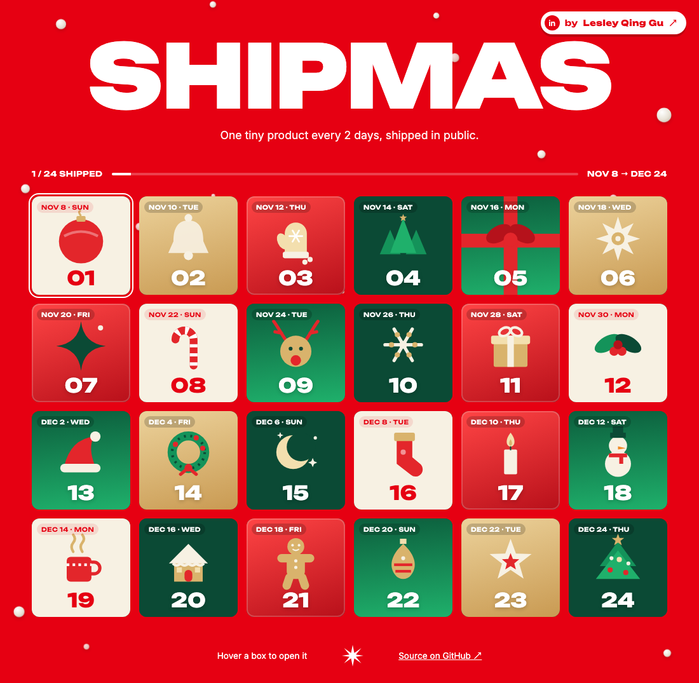
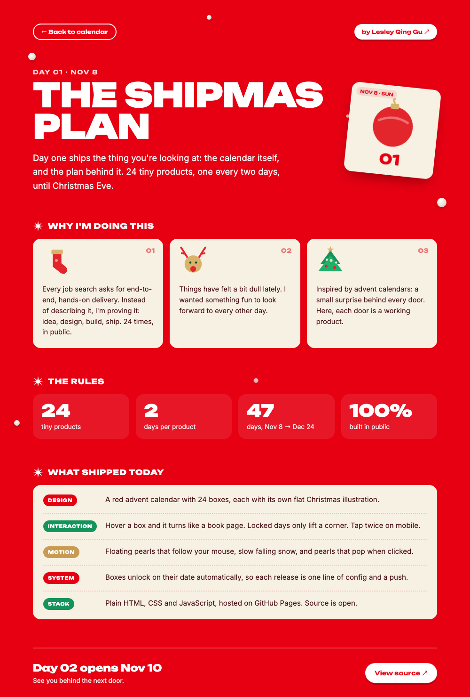
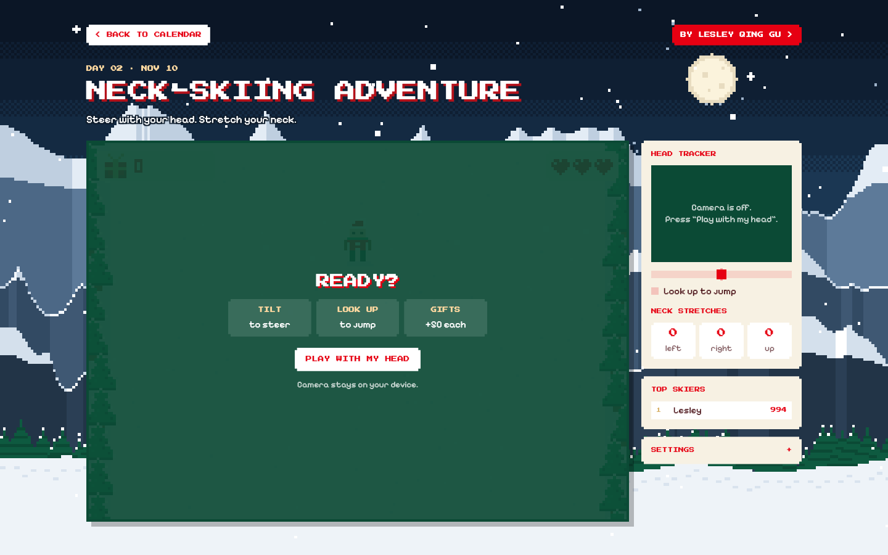

# 🎄 Shipmas

**A 24-day Christmas countdown design challenge.** One tiny product shipped every 2 days, from Nov 8 to Dec 24, all built end to end and shipped in public.

👉 **Live:** https://lesley-qing-gu.github.io/ChristmasChallenge/
🔗 **By:** [Lesley Qing Gu](https://www.linkedin.com/in/qing-gu-072167322)

## The idea

I've always loved advent calendars, with a tiny surprise behind every door. Shipmas is one where every door is a real, working product. Each box unlocks on its date, and each one goes from idea to design, build and launch.

- **24** tiny products
- **1** every **2** days
- **Nov 8 → Dec 24** (47 days)

## What's behind the doors

| Day | Date | Project | Status |
| --- | --- | --- | --- |
| 01 | Nov 8 | [The Shipmas Plan](#day-01--the-shipmas-plan) | ✅ Shipped |
| 02 | Nov 10 | [Neck-Skiing Adventure](#day-02--neck-skiing-adventure) | ✅ Shipped |
| 03 | Nov 12 | — | 🔒 |
| 04 | Nov 14 | — | 🔒 |
| 05 | Nov 16 | — | 🔒 |
| 06 | Nov 18 | — | 🔒 |
| 07 | Nov 20 | — | 🔒 |
| 08 | Nov 22 | — | 🔒 |
| 09 | Nov 24 | — | 🔒 |
| 10 | Nov 26 | — | 🔒 |
| 11 | Nov 28 | — | 🔒 |
| 12 | Nov 30 | — | 🔒 |
| 13 | Dec 2 | — | 🔒 |
| 14 | Dec 4 | — | 🔒 |
| 15 | Dec 6 | — | 🔒 |
| 16 | Dec 8 | — | 🔒 |
| 17 | Dec 10 | — | 🔒 |
| 18 | Dec 12 | — | 🔒 |
| 19 | Dec 14 | — | 🔒 |
| 20 | Dec 16 | — | 🔒 |
| 21 | Dec 18 | — | 🔒 |
| 22 | Dec 20 | — | 🔒 |
| 23 | Dec 22 | — | 🔒 |
| 24 | Dec 24 | — | 🔒 |

---

## Day 01 · The Shipmas Plan

**Shipped Nov 8** · [Live page](https://lesley-qing-gu.github.io/ChristmasChallenge/days/01/) · Source: [`days/01/`](days/01)

The calendar itself, and the plan behind it.

- **Design:** a red advent calendar with 24 boxes, each with its own flat Christmas illustration (inline SVG, no image files).
- **Interaction:** hover a box and it turns like a book page. Locked days only lift a corner. On touch screens the first tap turns the page and the second opens it.
- **Motion:** floating pearls that follow the mouse, slow falling snow, and pearls that pop when clicked. Respects `prefers-reduced-motion`.
- **System:** boxes unlock on their date automatically, so each release is one line of config and a push.

## Day 02 · Neck-Skiing Adventure

**Shipped Nov 10** · [Play it](https://lesley-qing-gu.github.io/ChristmasChallenge/days/02/) · Source: [`days/02/`](days/02)

A pixel-art ski game you steer with your head, made to get desk workers moving their necks.

- **What it does:** tilt your head left or right to steer down a snowy slope, look up to jump fences, and collect gifts for bonus points. Every run counts your neck stretches, and the best scores go on a public leaderboard.
- **How it's built:** MediaPipe Face Landmarker runs in the browser and reads head roll and pitch from your webcam after a short calibration. The camera feed never leaves your device. The game draws on a 200×140 canvas scaled up pixel-perfect, with hand-made sprites, particle effects and a procedural snowy-mountain background. The leaderboard uses Firebase anonymous auth and Firestore: players just type a name, no account or email needed, and security rules check that every score is plausible.
- **What I learned:** head control needs per-player calibration and generous thresholds to feel fair, and a leaderboard can be privacy-light if the server rules do the validation.

