# 🎄 Shipmas

**A 24-day Christmas countdown design challenge.** One tiny product shipped every 2 days, from Nov 8 to Dec 24, all built end to end and shipped in public.

👉 **Live:** https://lesley-qing-gu.github.io/ChristmasChallenge/
🔗 **By:** [Lesley Qing Gu](https://www.linkedin.com/in/qing-gu-072167322)

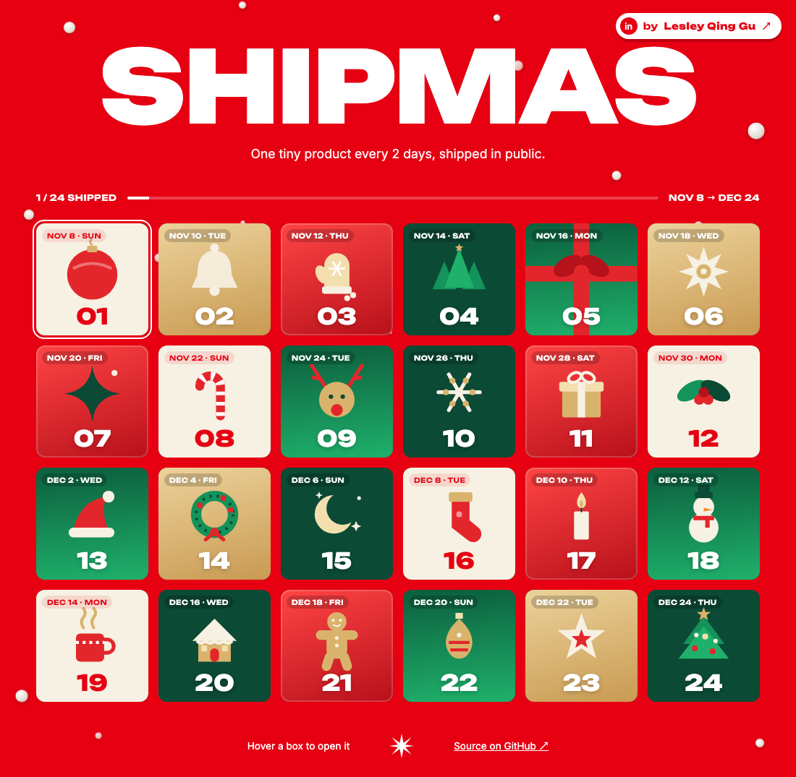

## The idea

I've always loved advent calendars, with a tiny surprise behind every door. Shipmas is one where every door is a real, working product. Each box unlocks on its date, and each one goes from idea to design, build and launch.

- **24** tiny products
- **1** every **2** days
- **Nov 8 → Dec 24** (47 days)

## What's behind the doors

| Day | Date | Project | Status |
| --- | --- | --- | --- |
| 01 | Nov 8 | [The Shipmas Plan](#day-01--the-shipmas-plan) | ✅ Shipped |
| 02 | Nov 10 | [Neck-Skiing Adventure](#day-02--neck-skiing-adventure) | ✅ Shipped |
| 03 | Nov 12 | [Cloud Climbing Gym](#day-03--cloud-climbing-gym) | ✅ Shipped |
| 04 | Nov 14 | [Lätt svenska 2026 in Review](#day-04--lätt-svenska-2026-in-review) | ✅ Shipped |
| 05 | Nov 16 | [MöleMe](#day-05--möleme) | ✅ Shipped |
| 06 | Nov 18 | [Read & Learn](#day-06--read--learn) | ✅ Shipped |
| 07 | Nov 20 | [Collie on the Wall](#day-07--collie-on-the-wall) | ✅ Shipped |
| 08 | Nov 22 | [Stockholm T Pendant](#day-08--stockholm-t-pendant) | ✅ Shipped |
| 09 | Nov 24 | [SmallTalk](#day-09--smalltalk) | ✅ Shipped |
| 10 | Nov 26 | [Podcast Desk](#day-10--podcast-desk) | ✅ Shipped |
| 11 | Nov 28 | — | 🔒 |
| 12 | Nov 30 | — | 🔒 |
| 13 | Dec 2 | — | 🔒 |
| 14 | Dec 4 | — | 🔒 |
| 15 | Dec 6 | — | 🔒 |
| 16 | Dec 8 | — | 🔒 |
| 17 | Dec 10 | — | 🔒 |
| 18 | Dec 12 | — | 🔒 |
| 19 | Dec 14 | — | 🔒 |
| 20 | Dec 16 | — | 🔒 |
| 21 | Dec 18 | — | 🔒 |
| 22 | Dec 20 | — | 🔒 |
| 23 | Dec 22 | — | 🔒 |
| 24 | Dec 24 | — | 🔒 |

---

## Day 01 · The Shipmas Plan

**Shipped Nov 8** · [Live page](https://lesley-qing-gu.github.io/ChristmasChallenge/days/01/) · Source: [`days/01/`](days/01)

The calendar itself, and the plan behind it.

- **Design:** a red advent calendar with 24 boxes, each with its own flat Christmas illustration (inline SVG, no image files).
- **Interaction:** hover a box and it turns like a book page. Locked days only lift a corner. On touch screens the first tap turns the page and the second opens it.
- **Motion:** floating pearls that follow the mouse, slow falling snow, and pearls that pop when clicked. Respects `prefers-reduced-motion`.
- **System:** boxes unlock on their date automatically, so each release is one line of config and a push.
- **Stack:** plain HTML, CSS and JavaScript, with no framework and no build step. CSS 3D transforms for the page turn, inline SVG for all 24 illustrations, CSS keyframes plus a small mousemove parallax for the pearls, and Google Fonts (Unbounded, Inter). The box list lives in one JS file so the page also works when opened from disk, and boxes unlock by date in the browser. Hosted on GitHub Pages, set up with the GitHub CLI.

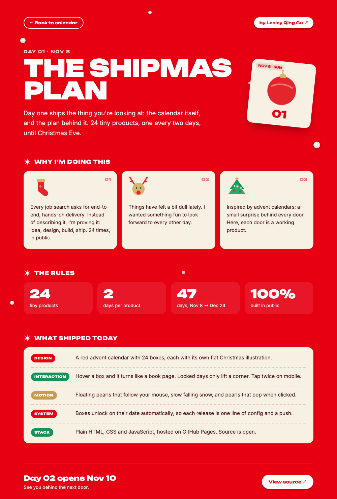

## Day 02 · Neck-Skiing Adventure

**Shipped Nov 10** · [Play it](https://lesley-qing-gu.github.io/ChristmasChallenge/days/02/) · Source: [`days/02/`](days/02)

A pixel-art ski game you steer with your head, made to get desk workers moving their necks.

- **What it does:** tilt your head left or right to steer down a snowy slope, look up to jump fences, and collect gifts for bonus points. Every run counts your neck stretches, and the best scores go on a public leaderboard.
- **How it's built:** MediaPipe Face Landmarker runs in the browser and reads head roll and pitch from your webcam after a short calibration. The camera feed never leaves your device. The game draws on a 200×140 canvas scaled up pixel-perfect, with hand-made sprites, particle effects and a procedural snowy-mountain background. The leaderboard uses Firebase anonymous auth and Firestore: players just type a name, no account or email needed, and security rules check that every score is plausible.
- **What I learned:** head control needs per-player calibration and generous thresholds to feel fair, and a leaderboard can be privacy-light if the server rules do the validation.
- **Stack:** plain HTML, CSS and JavaScript. MediaPipe Face Landmarker (tasks-vision 0.10.14, WebAssembly, runs in the browser) for head tracking. Canvas 2D at 200×140 with pixel-perfect scaling, sprites drawn from character maps, and a procedural mountain background. Firebase 10.12.2 (anonymous Auth + Firestore with security rules) for the leaderboard. Press Start 2P and Pixelify Sans fonts. Hosted on GitHub Pages.

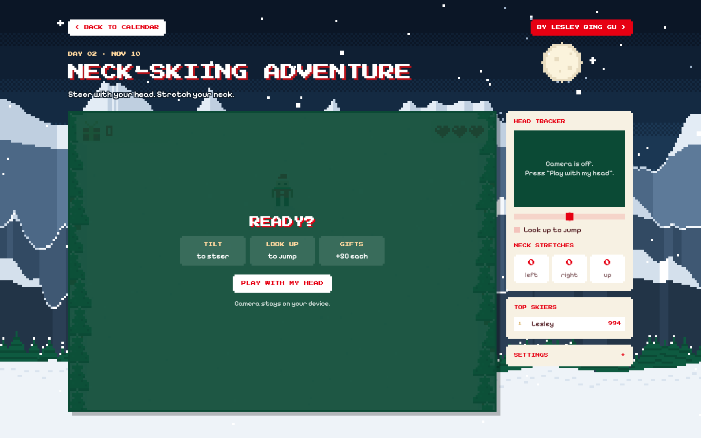

## Day 03 · Cloud Climbing Gym

**Shipped Nov 12** · [Take a lap](https://lesley-qing-gu.github.io/ChristmasChallenge/days/03/) · Source: [`days/03/`](days/03)

Gyms close over Christmas, so here is a cloud climbing gym to walk around instead. A first-person 3D tour dressed up for the holidays, with the layout based on BLX. An unofficial fan project, not affiliated with BLX.

- **What it does:** walk around with WASD or a touch joystick and drag to look. Jump between 12 photo stops from the entrance to the roof terrace, follow the minimap, dress up your climber and see yourself, and bump into anyone else who is in the gym at the same time.
- **How it's built:** I gave Fable 5.2 a few photos and the floor map in one prompt, and it generated the whole 3D scene. Then I reworked the interface, fixed camera collisions and odd furniture, and added multiplayer. Everything is modelled in code, with posters and signs drawn on canvas textures, so the only assets are 12 photos. Collision uses wall segments plus floor zones, so stairs and the upper floor work. Multiplayer uses Firebase anonymous auth and Realtime Database: each visitor writes one small record (position, facing, outfit, name) that is removed automatically on disconnect, and the security rules only allow writes to your own record with values in range.
- **What I learned:** one prompt with a few photos and a floor map can produce a surprisingly complete 3D scene, but the details (camera collisions, odd furniture, stop framing) still need a human eye. A third-person camera needs its own wall collision, or it ends up outside the room.
- **Stack:** Three.js 0.160 (WebGL, loaded with an import map) with bloom, ACES tone mapping and soft shadows. Everything is modelled in code, with posters and signs drawn on canvas textures. Firebase (anonymous Auth + Realtime Database with security rules) for live multiplayer. Plain HTML, CSS and JavaScript on GitHub Pages, no build step.

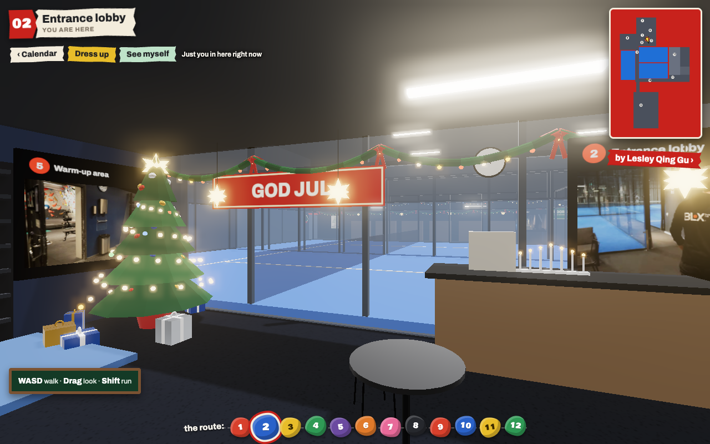

## Day 04 · Lätt svenska 2026 in Review

**Shipped Nov 14** · [Explore the year](https://lesley-qing-gu.github.io/ChristmasChallenge/days/04/) · Source: [`days/04/`](days/04)

I've listened to Radio Sweden på lätt svenska for a year while learning Swedish, and it felt like they talked about students all the time. So I analysed every 2026 episode to find out what they actually talked about most. An unofficial fan project, not affiliated with Sveriges Radio.

- **What it does:** a year-in-review page for 219 episodes (about 36 hours of audio): key findings, topics ranked by attention, topics by month, the top 100 words with search, frequent phrases and the most mentioned names. Plus a free Anki deck of the 1000 most frequent words (English or Chinese), each card with a real sentence from the show.
- **How it's built:** episode audio comes from the Sveriges Radio open API and was transcribed locally with Whisper large-v3-turbo on MLX. The transcripts were analysed in Python: topics are tagged sentence by sentence with keywords, and words are counted by lemma with simplemma plus manual fixes. The word list became Anki decks. The page itself is plain HTML, CSS and JavaScript, styled as a Swedish Christmas (julröd, an advent candle arch, dala horses and straw goats). The full transcripts stay offline, since they are Sveriges Radio content.
- **What I learned:** my hunch was half right. The election was by far the biggest topic, but school, children and young people came second, in 189 of 219 episodes. Whisper is good enough for word counts, but it still misspells names and needs a filter for hallucinated lines.
- **Stack:** Sveriges Radio open API, Whisper large-v3-turbo (MLX), Python with simplemma, Anki decks, and a plain HTML/CSS/JS page on GitHub Pages.

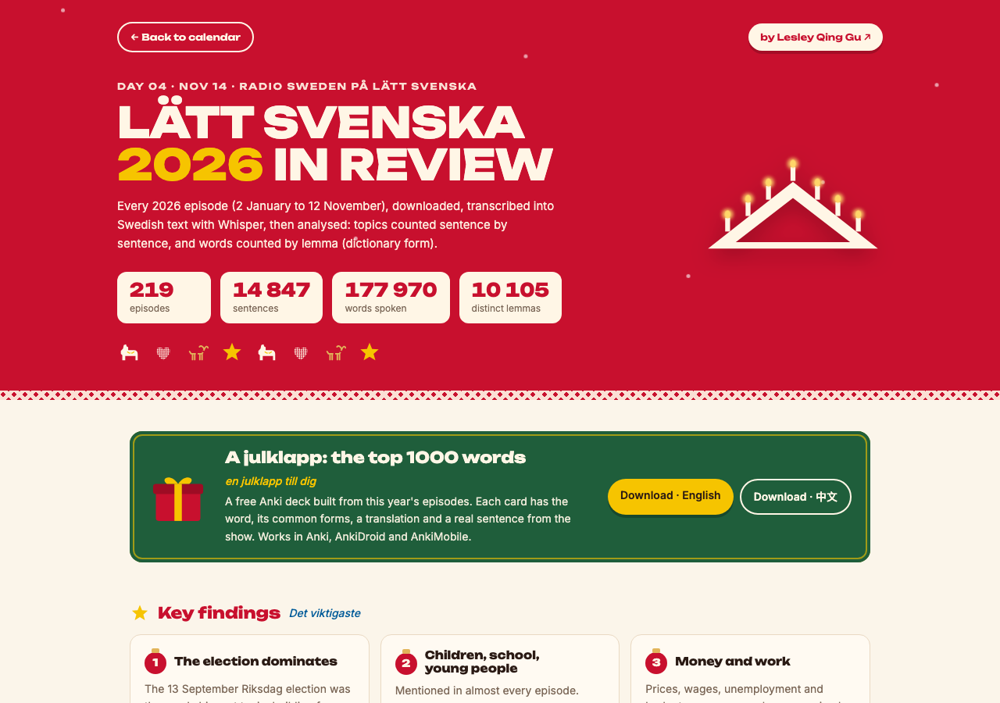

## Day 05 · MöleMe

**Shipped Nov 16** · [Sit at the desk](https://lesley-qing-gu.github.io/ChristmasChallenge/days/05/) · Source: [`days/05/`](days/05)

Work hard, slack harder. A 3D desk by a window at blue hour, full of things to slack with, and behind the screen an English remake of my earlier Windows 98 "slacking terminal", [MoLeMe](https://github.com/Lesley-Qing-Gu/MoLeMe).

- **What it does:** play with the desk (tissues, bubble wrap, a snow globe, cinnamon buns, advent candles, drawers, a Dala horse, a julbock, readable books and a wordless flat-pack manual), then click the monitor to clock in: paid-slacking timer, wooden fish, rant bin, boss-panic report and a fake update stuck at 99%. A hidden four-letter puzzle across the desk unlocks a drawer and a certificate with your solve time.
- **How it's built:** Three.js with bloom, ACES tone mapping and soft shadows. Every object is modelled in code and every texture (sky, city, posters, book spines) is drawn on canvas, so there are no image or 3D files. Clicks use raycasting with per-object hotspots. The Win98 app was ported from React + Vite to plain JavaScript modules. Sounds are synthesised with the Web Audio API, and progress is kept in localStorage.
- **What I learned:** point clouds have a huge default pick radius in three.js, so the snow globe was quietly eating every click on the desk. And a puzzle is only fun if nothing on screen gives the answer away.
- **Stack:** Three.js 0.160 (import map, no build step), Web Audio API, plain HTML/CSS/JS on GitHub Pages.

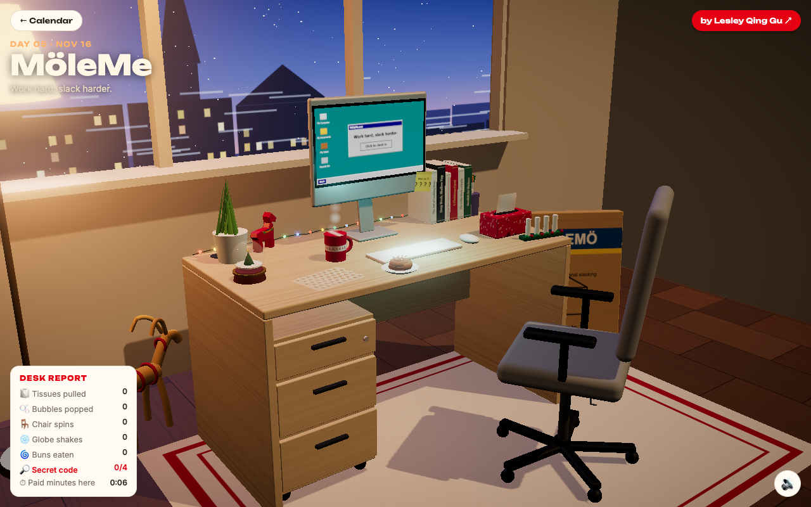

## Day 06 · Read & Learn

**Shipped Nov 18** · [Start reading](https://lesley-qing-gu.github.io/ChristmasChallenge/days/06/) · Source: [`days/06/`](days/06)

I learn Swedish by reading novels, but I kept looking up the same words and forgetting them. This is a reading tool that looks words up in context, explains them properly and brings them back until they stick.

- **What it does:** paste or upload a text, or take a photo of a page. Tap a word or drag across a phrase to see its base form, part of speech, inflected forms, meaning in context, a usage note and an example, and hear it pronounced. Meanings come in your own language plus up to two more of your choice (English by default). Save words to word books; saved words are underlined wherever they appear again. Review with spaced-repetition flashcards, delete the ones you know, and export to Anki. Translate the whole text sentence by sentence. Works for most languages that separate words with spaces, with the interface and explanations in your own language.
- **How it's built:** one HTML file with plain JavaScript and no server. The browser calls the Claude API or the OpenAI API directly with the visitor's own key (the key decides which), and the key is stored only in that browser. Sentence splitting handles abbreviations, and pasted text with hard line breaks is rejoined automatically. Interface languages other than English and Chinese are translated once by Claude and cached. Pronunciation uses the browser's built-in speech synthesis. Words and texts live in localStorage, with JSON backup and restore.
- **What I learned:** looking a word up is easy; remembering it is the hard part. Seeing a saved word underlined in the next chapter is a much better reminder than any review schedule.
- **Stack:** plain HTML/CSS/JS, Claude API (Haiku 5.5 by default, Sonnet for reading photos) or OpenAI API (GPT-6 Luna by default), localStorage, GitHub Pages.

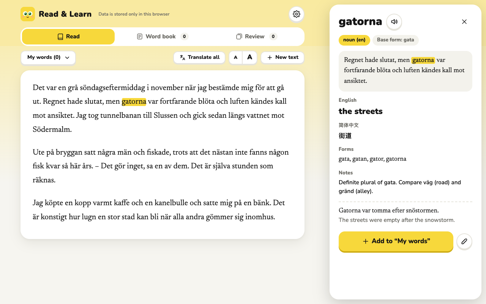

## Day 07 · Collie on the Wall

**Shipped Nov 20** · [Pick your favourite](https://lesley-qing-gu.github.io/ChristmasChallenge/days/07/) · Source: [`days/07/`](days/07)

Three videos of a border collie bouldering on a real wall. Two came from the same wall photo and the same one-line prompt ("Make a video of a border collie climbing here"). The third was made a different way. Pick the one you like best, and the page reveals how each was made.

- **What it does:** plays three vertical videos side by side (stacked on phones), lets you pick a favourite, then reveals the tool behind each one. Your pick is remembered in the browser.
- **How it's built:** one HTML file with plain CSS and JavaScript, with canvas snowfall and an SVG string of lights. The videos were re-encoded with ffmpeg to silent H.264 at 1280px tall with faststart, about 4 MB in total. Only videos on screen play, to save battery and data on phones.
- **What I learned:** a one-line prompt easily gets you a dog on a wall. Getting it to climb like a climber takes more than a prompt.
- **Stack:** Seedance, Kling, Claude, ffmpeg, plain HTML/CSS/JS on GitHub Pages.

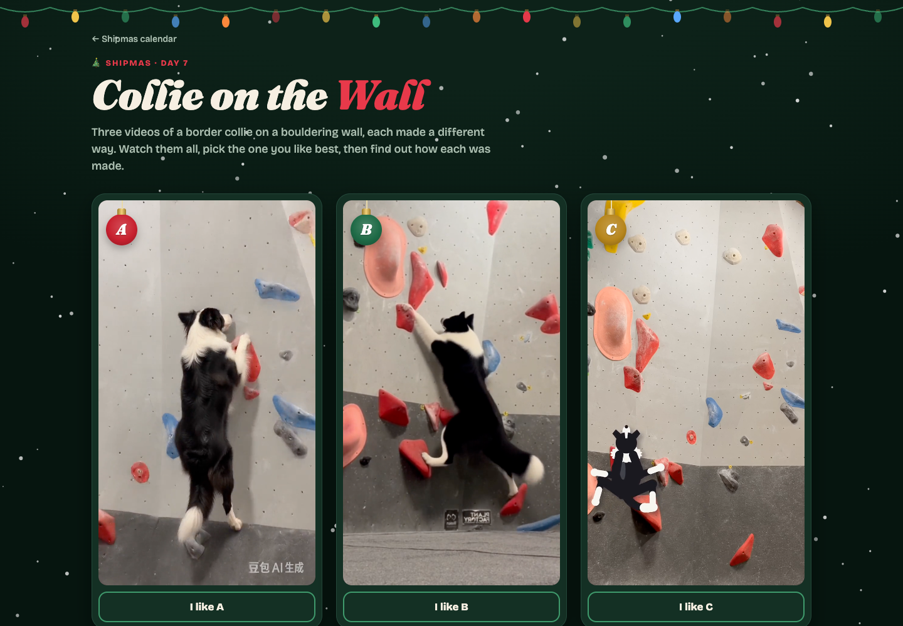

## Day 08 · Stockholm T Pendant

**Shipped Nov 22** · [See it and download the STL](https://lesley-qing-gu.github.io/ChristmasChallenge/days/08/) · Source: [`days/08/`](days/08)

Today's product is a physical one: a 3D-printed pendant, 39 mm tall, with a Stockholm metro T on three faces, so it shows a T from every side. Print it in green, red or blue for your line.

- **What it does:** a product film, a 3D model you can spin and zoom and preview in each line's colour, and a free STL to print your own.
- **How it's built:** the pendant was modelled as one solid and printed layer by layer. The page is one HTML file: three.js loads the STL straight into the viewer (only once it scrolls into view) and orbit controls handle drag and pinch. The film was compressed with ffmpeg from 48 MB to under 3 MB.
- **What I learned:** a T that reads from every angle is a geometry puzzle, not a decal. And a real object in your palm lands very differently from anything on a screen.
- **Stack:** 3D modelling and FDM printing, three.js 0.160 (STLLoader, OrbitControls), ffmpeg, plain HTML/CSS/JS on GitHub Pages.

A fan-made tribute, not affiliated with SL or Region Stockholm.

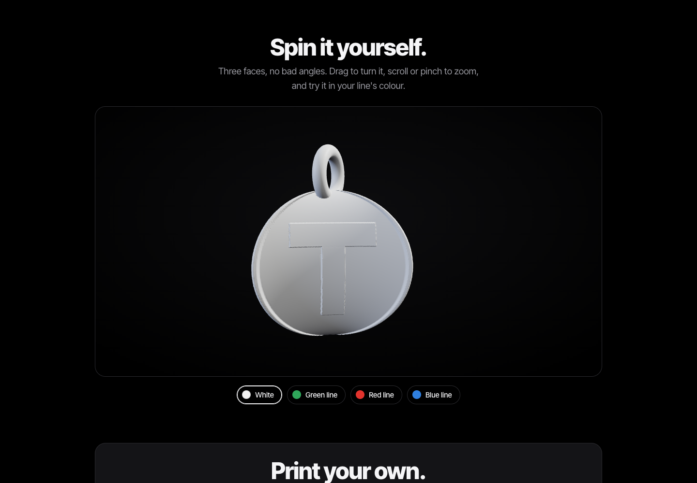

## Day 09 · SmallTalk

**Shipped Nov 24** · [Start talking](https://lesley-qing-gu.github.io/ChristmasChallenge/days/09/) · Source: [`days/09/`](days/09)

I can read Swedish far better than I can speak it. SmallTalk is a pocket speaking coach: every day Moose goes somewhere new, and you practise the conversation you'd have there.

- **What it does:** each day on the calendar is a situation (a café, the doctor, a job interview, the neighbour, or anything you type). Pick a level and a conversation partner to get a natural dialogue with vocabulary, pronunciation tips and a cultural note, then keep talking or ask about it. In speaking practice you answer a question by typing or talking and get feedback on grammar and naturalness. Eight languages to learn, with translations and feedback in any of the eight; the interface is in English or Chinese. Installable as a PWA.
- **How it's built:** one HTML file with plain JavaScript and no server. The browser calls the Claude API or the OpenAI API directly with the visitor's own key (the key decides which), and every reply is structured JSON. Read aloud uses speechSynthesis and dictation uses the Web Speech API. A service worker caches the app shell. Opened as a claude.ai artifact, the same file uses Claude's built-in features instead.
- **What I learned:** the hardest part of speaking is not knowing the words but having them ready when someone is waiting. A partner who pushes back is much better practice than a polite one.
- **Stack:** plain HTML/CSS/JS, Claude API (Sonnet 5.5 by default) or OpenAI API, Web Speech API, service worker, localStorage, GitHub Pages.

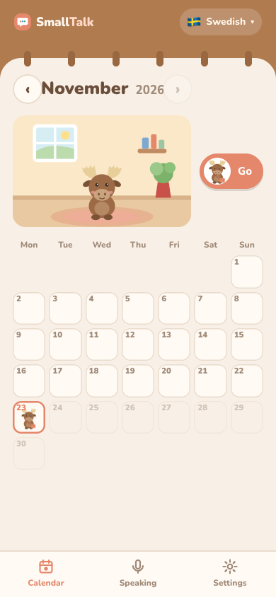

## Day 10 · Podcast Desk

**Shipped Nov 26** · [See the demo and download](https://lesley-qing-gu.github.io/ChristmasChallenge/days/10/) · Source: [`days/10/podcast-desk/`](days/10/podcast-desk)

Edit a podcast by editing its transcript. I built it to edit my own podcast and turned it into something anyone can run.

- **What it does:** upload a recording and it's transcribed, split by speaker and rough-cut automatically (ums, false starts, coughs, cross-talk, breaths, long gaps). Then delete or move words like tracked changes in Word and the audio follows; play back the edit with word highlighting; remove filler words in one go; even out pauses; change one speaker's speed; export a clean mp3 with optional loudness levelling and noise removal; optionally write show notes with Claude Code. English and Chinese interface.
- **How it's built:** a small Python web server on your own computer and a single-page editor in the browser. Whisper transcribes (MLX on Apple Silicon, faster-whisper elsewhere, CUDA when available), pyannote finds speakers and cross-talk, and numpy + ffmpeg handle silence detection, cutting with crossfades, tempo changes and loudness. Every word keeps its timestamps, so the edited text maps straight back to time ranges in the original audio.
- **What I learned:** Whisper's word timestamps often include the silence after a word, so before cutting I tighten each word to where the sound actually is. And Whisper quietly drops "um" unless the prompt shows it some.
- **Stack:** Python, numpy, ffmpeg, Whisper (mlx-whisper / faster-whisper), pyannote.audio, plain HTML/CSS/JS. No API key.

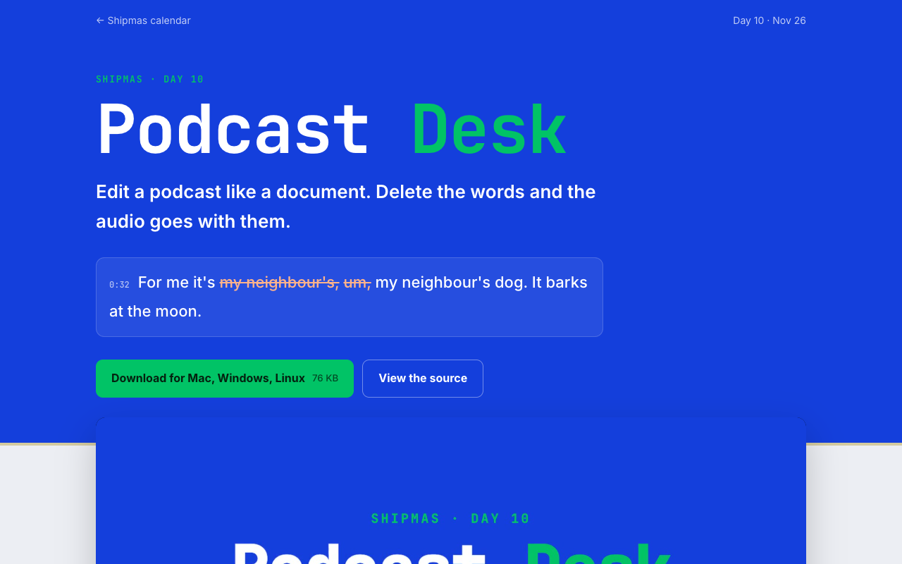
